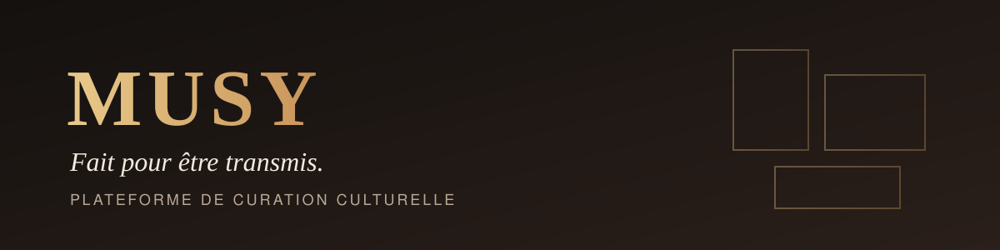

 

**[musy.gallery](https://musy.gallery)** · **[Ouvrir l'application](https://app.musy.gallery)** · **[contact@musy.gallery](mailto:contact@musy.gallery)**

---

## Qui est MUSY

MUSY SAS développe **Musy**, une plateforme de curation qui prend la forme que son utilisateur lui donne.

Chaque service garde un morceau de ce que vous aimez : une plateforme vos vidéos, une autre vos sons, une autre vos publications. L'ensemble n'existe nulle part. Musy se connecte aux outils que vous utilisez déjà et le rassemble au même endroit, pour que vous puissiez le **retrouver**, le **réutiliser** et le **transmettre**.

L'idée vient d'un musée sans murs, imaginé en 1947 : une culture qui se garde, se compose et se partage.

## Ce que fait Musy

| | |
|---|---|
| **Rassembler** | Connecter ses sources existantes, sans ressaisie ni migration. |
| **Conserver** | Chaque élément garde son contexte dans une collection organisée à sa façon, au lieu d'un lien mort dans une liste sans fin. |
| **Réutiliser** | Recomposer, partager, republier, et faire ressortir la matière vers d'autres outils. |

## Une plateforme qui se règle

Musy ne vous impose pas une forme unique :

- **Un algorithme qui s'explique** : il dit pourquoi il montre un contenu, et vous pouvez le corriger.
- **Des modules que l'on active ou non**, par personne comme par organisation.
- **Une apparence au choix**, jusqu'aux couleurs d'une organisation.
- **Un partage précis** : vous décidez de ce qui sort, et vers qui.

Selon l'usage, Musy devient un réseau, une bibliothèque privée, une galerie publique ou un espace d'équipe.

## Pour les organisations

Entreprises, universités, musées, institutions : un même besoin, garder une trace de ses contenus, les assembler avec d'autres sources, créer avec, partager et faire de la veille. Musy leur offre un espace commun où rassembler, conserver, réutiliser et transmettre.

## Liens

| | |
|---|---|
| 🌐 **Site** | [musy.gallery](https://musy.gallery) |
| 📲 **Application** | [app.musy.gallery](https://app.musy.gallery) |
| ✉️ **Contact** | [contact@musy.gallery](mailto:contact@musy.gallery) |

---

MUSY SAS · France · Fait pour être transmis.

